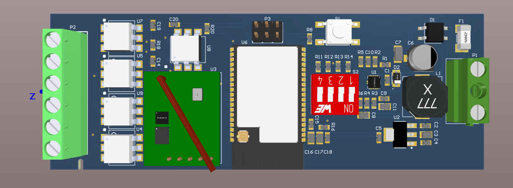
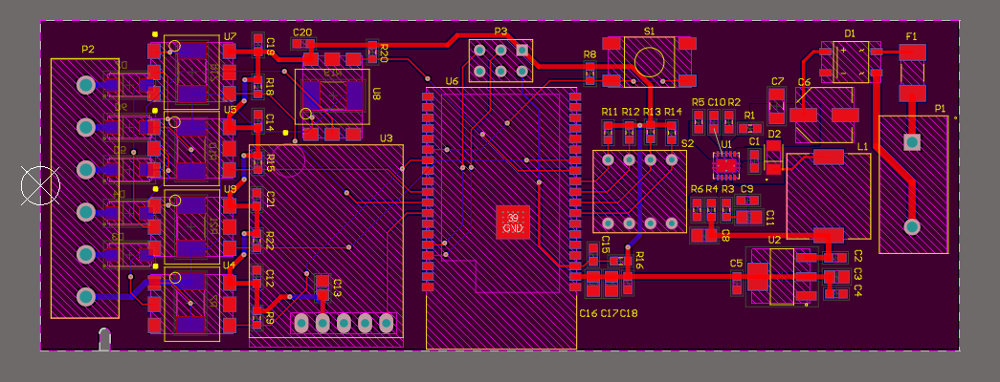
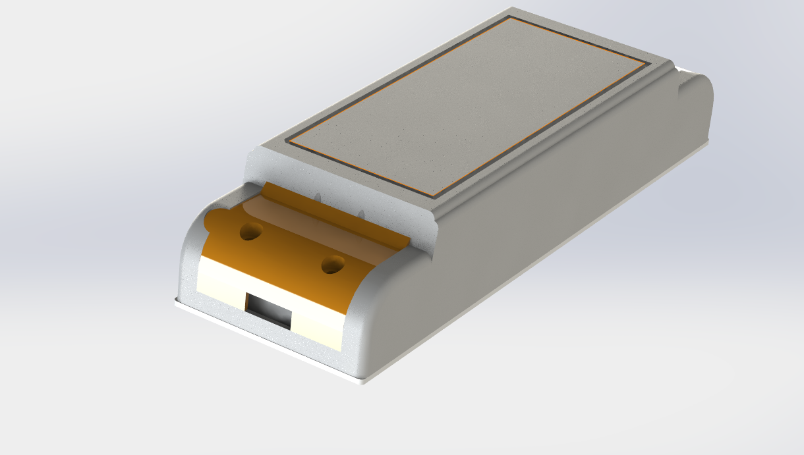
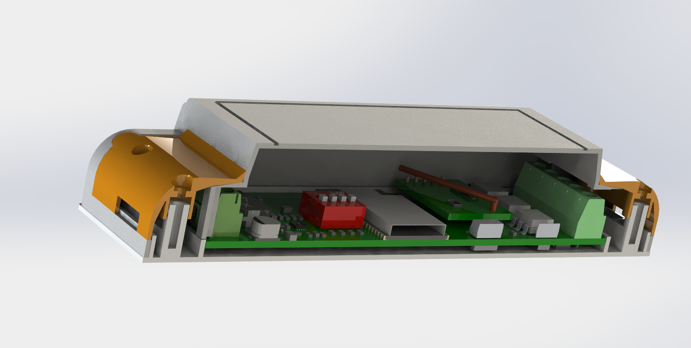
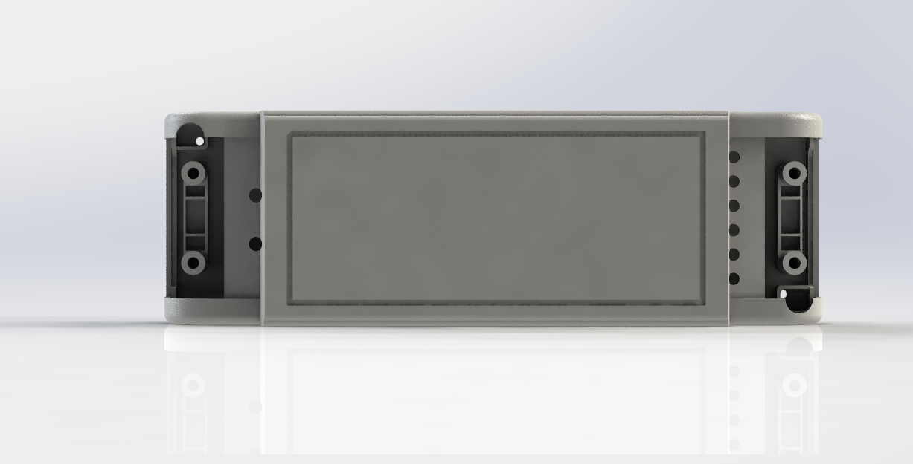
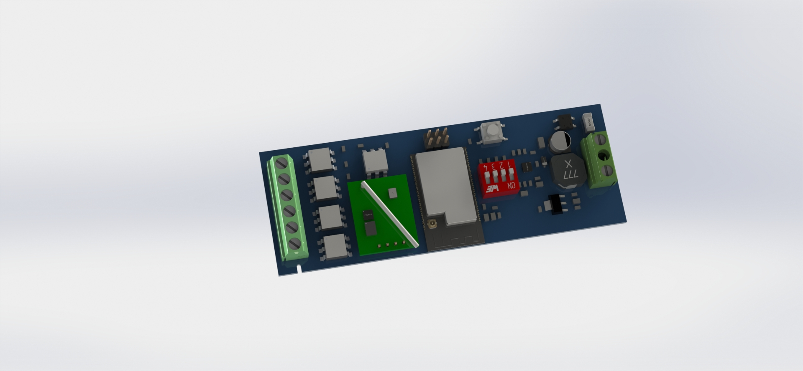

# ESP32 Relay Switch PCB (variant 2)

Custom PCB that integrates an ESP32 microcontroller with a mains-rated relay to
enable wireless control (via Wi-Fi or Bluetooth) of AC appliances. This variant
comes with its own enclosure, designed in SolidWorks.

| 3D view | 2D layout |
| --- | --- |
| [](images/pcb-3d-view.png) | [](images/pcb-layout-2d.png) |

| Enclosure | Enclosure section | Enclosure bottom |
| --- | --- | --- |
| [](images/enclosure-3d-view.png) | [](images/enclosure-section-view.png) | [](images/enclosure-bottom-view.png) |

[](images/pcb-3d-render.jpg)

## On the board

| Ref | Part | Role |
| --- | --- | --- |
| U6 | ESP32-WROVER | Wi-Fi / Bluetooth microcontroller module |
| U3 | Milight PCB-KH01 | RF receiver module |
| U1, L1 | TPS54140A + 22 µH | Buck converter from the 24 VDC input |
| U2 | TLV1117LV33 | 3.3 V LDO regulator |
| U4, U5, U7–U9 | H11L1SR2M | Optocouplers for the 6-way field terminal |
| P1 | 2-way terminal block | 24 VDC input |
| P2 | 6-way terminal block, 5.08 mm | Field I/O |
| P3 | 2×3 header | UART programming |
| S1, S2 | Push button, 4-way DIP switch | User input / configuration |

## Repository layout

```
ESP32-Relay-Switch-var-2/
├── PCB/                             # Altium Designer project
│   ├── CAO_DMX.PrjPCB               # Project file (open this)
│   ├── CAO_DMX.SchDoc               # Schematic
│   ├── CAO_DMX.PcbDoc               # PCB layout
│   ├── CAO_DMX.PCBDwf               # Draftsman drawing
│   ├── CAO_DMX.OutJob, OutJob.OutJob # Output jobs
│   └── Project Outputs for CAO_DMX/ # Generated BOM, PDFs and STEP
├── mechanical/                      # SolidWorks enclosure
│   ├── Assembly.SLDASM              # Enclosure + PCB assembly (open this)
│   ├── Assembly.SLDDRW              # Assembly drawing
│   ├── CAO_DMX.PCB.SLDPRT           # PCB model
│   ├── Part_1_base.SLDPRT, Part_2_cover.SLDPRT, Part_3_lids.SLDPRT
│   ├── Cover_original.SLDPRT
│   └── drawings/                    # PDF exports of the drawings
└── images/                          # Renders used in this README
```

## Component library

This repo stores no libraries. Every part comes from the general Altium library
in [Gueni/0000_libraries](https://github.com/Gueni/0000_libraries):

| File | Used for |
| --- | --- |
| [`Altium/DATABASE.DbLib`](https://github.com/Gueni/0000_libraries/blob/master/Altium/DATABASE.DbLib) | Database library the schematic components link to |
| [`Altium/DB.mdb`](https://github.com/Gueni/0000_libraries/blob/master/Altium/DB.mdb) | Parts database (part numbers, MPNs, suppliers) |
| [`Altium/SCH.SchLib`](https://github.com/Gueni/0000_libraries/blob/master/Altium/SCH.SchLib) | Schematic symbols |
| [`Altium/FTP.PcbLib`](https://github.com/Gueni/0000_libraries/blob/master/Altium/FTP.PcbLib) | PCB footprints and 3D models |

### Setup

The project finds the library through a relative path, so clone both repos side
by side in the same workspace folder:

```
WORKSPACE/
├── 0000_libraries/                   # git clone https://github.com/Gueni/0000_libraries.git
└── 0006_esp32_2/
    └── ESP32-Relay-Switch-var-2/     # this repo
```

The project file references `..\..\..\0000_libraries\Altium\DATABASE.DbLib` and
adds `..\..\..\0000_libraries\Altium\` as a library search path. The DbLib's
database path is absolute (`D:\WORKSPACE\0000_libraries\Altium\DB.mdb`); see the
[library README](https://github.com/Gueni/0000_libraries#setup) if your
workspace lives elsewhere.
